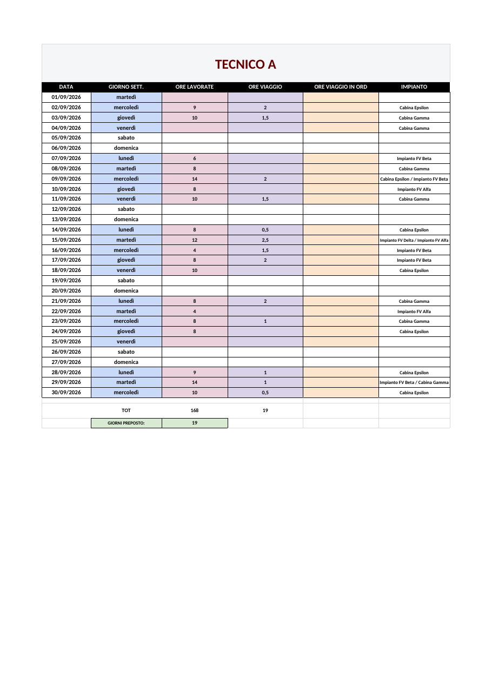
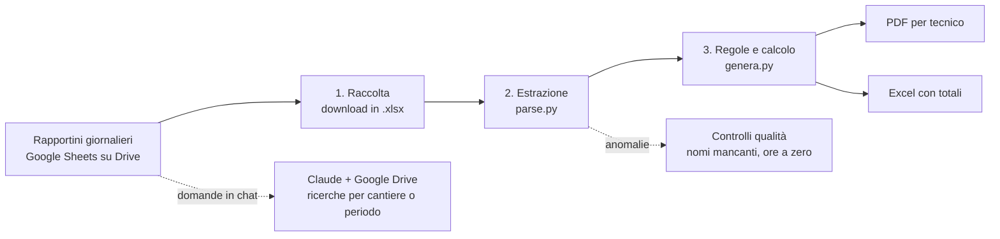

# Automazione del riepilogo ore dei tecnici

Pipeline Python che trasforma i rapportini giornalieri delle squadre di tecnici in un riepilogo mensile pronto per l'amministrazione: **un PDF per ogni tecnico e un file Excel con i totali**. Con Claude collegato a Google Drive gli stessi dati si interrogano anche in chat, per cantiere o per periodo.
Sviluppata per l'azienda in cui lavoro e in uso ogni mese: ha sostituito un lavoro manuale di **5–6 giorni** con un processo automatico, riducendo drasticamente il rischio di errore.

> I dati in questa cartella sono **inventati** (Tecnico A, Tecnico B, Impianto FV Alfa…). Nessun nome o dato aziendale reale è pubblicato.



## Il problema

Ogni squadra compila su Google Sheets un rapportino al giorno: un file per squadra, un foglio per ogni giorno del mese. A fine mese bisognava ricostruire a mano, tecnico per tecnico, ore lavorate, ore di viaggio, impianti e giorni da preposto. Un lavoro lungo, ripetitivo e facile da sbagliare.

## Come funziona



1. **Raccolta**: i rapportini del mese vengono scaricati dalla cartella Google Drive (un file per squadra).
2. **Estrazione** (`src/parse.py`)
   - legge solo i fogli giorno (`1`…`31` e `11b` per un secondo impianto nello stesso giorno) e **ignora il foglio `recap`**, che salta i fogli `Nb`;
   - individua la tabella tra l'intestazione `DATA | NOME TECNICO` e la riga `ATTIVITA' SVOLTE:`;
   - estrae data, tecnico, preposto, straordinario, ore totali, ore di viaggio e impianto;
   - normalizza i formati delle ore (orari Excel, numeri decimali, durate).
3. **Regole e calcolo** (`src/genera.py`)
   - più impianti nello stesso giorno: ore sommate e impianti uniti con ` / `;
   - **giorni da preposto** contati solo se il tecnico ha ore lavorate (i giorni di solo viaggio non contano);
   - **squadra dinamica**: ogni tecnico nuovo ottiene automaticamente la sua scheda; chi ha zero ore viene escluso.
4. **Output**
   - un PDF con una pagina per tecnico (giorni feriali colorati, weekend in bianco, totali e giorni da preposto);
   - un Excel con un foglio per tecnico e totali calcolati con formule `SUM`;
   - una cartella con un PDF separato per ogni tecnico e la sottocartella `Riepilogo completo`.

### Controlli di qualità
- `parse.py` stampa una riga `CHECK` per ogni riga con nome mancante o ore lavorate a zero, da verificare.
- `genera.py` verifica che il numero di pagine PDF coincida con il numero di tecnici e che il riepilogo contenga sia il PDF sia l'Excel.

### Ricerche in linguaggio naturale con Claude
Oltre ai report mensili, i rapportini su Google Drive si possono interrogare direttamente in chat: con Claude collegato a Drive basta chiedere, per esempio, *"quante ore sono state fatte sull'impianto Alfa a settembre?"* o *"chi ha lavorato in cantiere tra il 10 e il 20 del mese?"*. La risposta arriva in pochi secondi, filtrata per cantiere, tecnico o periodo, senza aprire i file uno per uno.

## Provalo

```bash
pip install -r requirements.txt
cd src
python3 genera_dati_esempio.py ../esempio/rapportini 2026 9   # crea rapportini fittizi
python3 parse.py ../esempio/rapportini rows.json               # estrazione + controlli
python3 genera.py rows.json 2026 9 ../output                   # PDF ed Excel
```

Su **Windows** usa `python` (o `py`) al posto di `python3`. Per scaricare il progetto: pulsante verde **Code → Download ZIP** nella pagina principale del repository, poi apri il terminale nella cartella `01-automazione-ore-tecnici`.

Cosa vedrai: `parse.py` stampa una riga `CHECK` per ogni riga sospetta, `genera.py` stampa i totali di ogni tecnico. Nella cartella `output/` trovi il PDF, l'Excel e una cartella con un PDF per tecnico.

Il PDF usa Carlito su Linux, Calibri su Windows e, se nessuno dei due è installato, Helvetica. Il risultato dell'esempio è già in [`esempio/`](esempio/).

## Struttura

```
01-automazione-ore-tecnici/
├── src/
│   ├── genera_dati_esempio.py  rapportini fittizi nello stesso formato di quelli reali
│   ├── parse.py                estrazione dei dati e controlli
│   └── genera.py               calcolo, PDF ed Excel
├── esempio/
│   ├── rapportini/             input di esempio (2 squadre, settembre 2026)
│   └── Ore Tecnici Settembre 2026/   output: un PDF per tecnico + riepilogo completo
└── requirements.txt
```

## Competenze dimostrate
Data cleaning su dati reali e disordinati · regole di business tradotte in codice · automazione end-to-end · reportistica (PDF ed Excel) · sviluppo assistito da AI (Claude) · interrogazione dei dati in linguaggio naturale · integrazione con Google Drive.

**Strumenti:** Python, openpyxl, reportlab, pypdf, Google Sheets / Drive, Claude.
