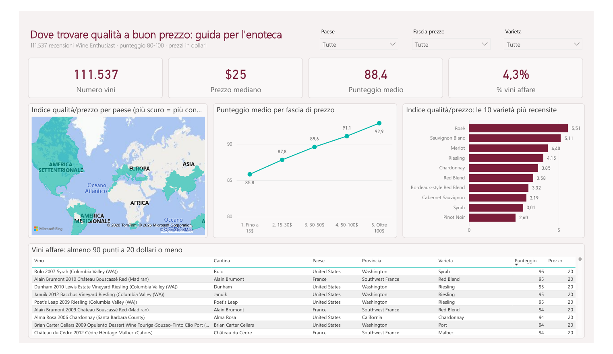

# Dashboard Power BI: qualità a buon prezzo per un'enoteca

**Obiettivo:** aiutare un'enoteca a scegliere quali vini mettere a scaffale, cercando quelli con il miglior rapporto tra qualità e prezzo.

## Dati
Dataset pubblico di recensioni Wine Enthusiast: circa 130.000 recensioni, con punteggio da 80 a 100 e prezzo in dollari.

## Come l'ho costruita
1. **Pulizia in Python** ([pulizia_vini.py](pulizia_vini.py)): tolgo i duplicati e le righe senza prezzo, paese o varietà (restano **111.537 vini**). Poi ricavo l'annata dal nome del vino, creo le fasce di prezzo e il giudizio a parole (da "Buono" a "Straordinario") e traduco le colonne in italiano.
2. **Modello dati in Power BI** ([modello_dati](modello_dati/)): importo il CSV con Power Query e scrivo **8 misure DAX**, tra cui:
   - `Indice qualita prezzo = AVERAGEX(Vini, DIVIDE(Vini[Punteggio], Vini[Prezzo]))`
   - `Vini affare = CALCULATE([Numero vini], Vini[Punteggio] >= 90, Vini[Prezzo] <= 20)`
   - `% vini affare`, `% vini eccellenti`, `Prezzo mediano`, `Punteggio medio`
3. **Dashboard su una pagina**: 4 KPI, una mappa dei paesi colorata per indice qualità/prezzo, il punteggio medio per fascia di prezzo, le 10 varietà più recensite e la tabella dei "vini affare". Ci sono filtri per paese, fascia di prezzo e varietà.

## Cosa emerge
- Spendere di più fa salire il punteggio, ma sempre meno: si passa da 85,8 punti sotto i 15 $ a 92,9 punti oltre i 100 $.
- Solo il **4,3%** dei vini è un vero affare (almeno 90 punti a 20 $ o meno).
- **Cile e Portogallo** hanno il miglior rapporto qualità/prezzo. Il Portogallo arriva in media a **88 punti con un prezzo mediano di 17 $**.
- Tra le varietà più diffuse convengono di più Rosé e Sauvignon Blanc. Pinot Noir e Syrah costano di più per lo stesso punteggio.

📄 [Dashboard in PDF](dashboard.pdf) · **Strumenti:** Python (Pandas), Power BI (Power Query, DAX).

> La cartella `modello_dati` contiene il modello semantico in formato Power BI Project (TMDL), con le misure DAX e la query di importazione. Per usarlo, salva `vini_puliti.csv` in `C:\PowerBI\` oppure cambia il percorso nella query.
